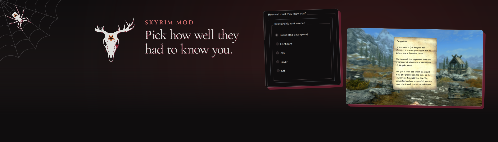
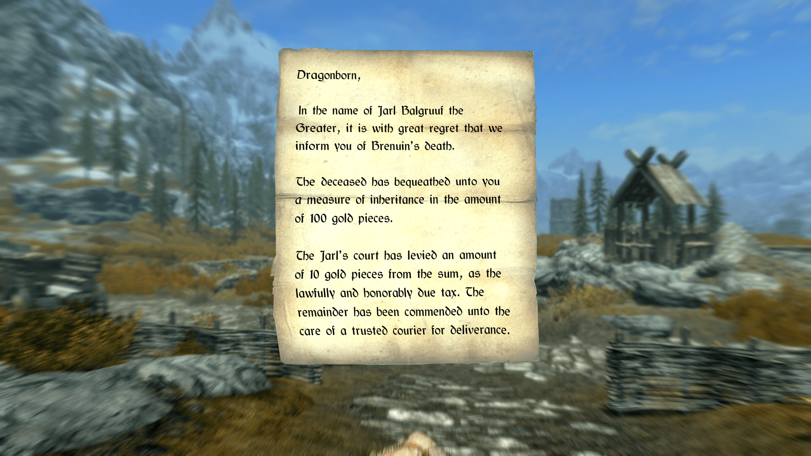
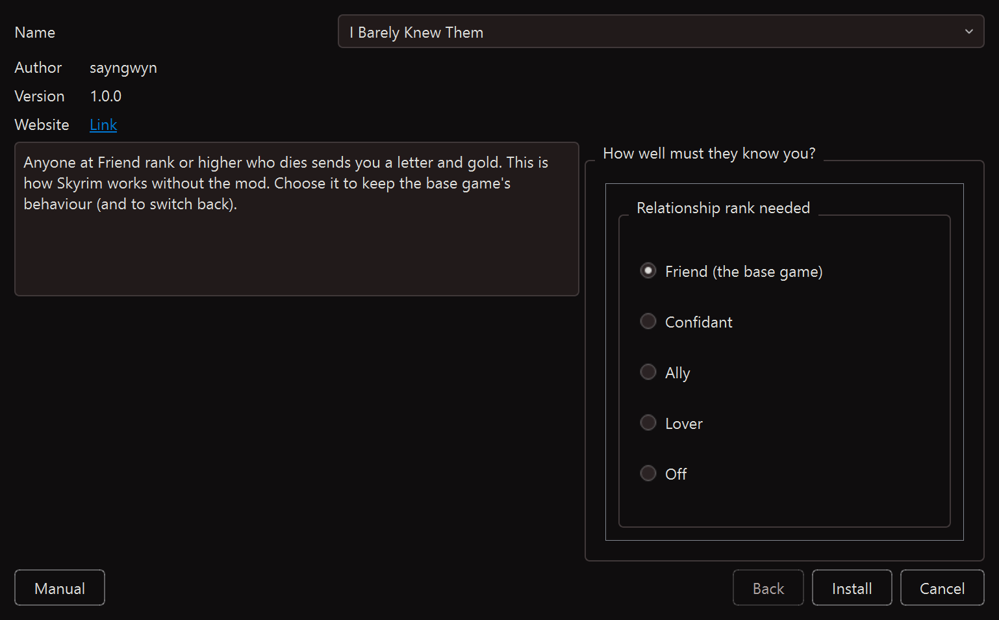

In the base game, anyone who counts you as a Friend sends you an inheritance letter and gold when they die, even someone you barely knew. This lets you choose how well they had to know you first, or turn the letters off.

<picture>
  <source media="(prefers-color-scheme: dark)" srcset="docs/divider.png">
  
</picture>

## How it works

- **Only people who know you send one.** Pick how well someone must know you before their death sends you an inheritance letter and gold.
- **Five choices in the installer:** Friend (the base game), Confidant, Ally, Lover, or Off (no letters at all).
- **Gold and letters are untouched.** Whoever still qualifies sends the same letter and the same gold as before.
- **Nothing running:** no scripts, no SKSE, one tiny plugin per choice.

## Install

1. Install with your mod manager and pick a rank in the installer.
2. Load it after the Unofficial Skyrim Special Edition Patch if you use that patch. It carries that patch's one change to this quest, so it works with or without the patch.
3. To change your pick later, reinstall and choose again.

**Needs:** Skyrim Special Edition or Anniversary Edition. Nothing else.

**Tested on:** SE and AE (1.6.1170 and 1.7.104).

## Good to know

- **Works on an existing save.** I loaded a save made without the mod, with the plugin added afterwards, on Skyrim 1.7.104, and it behaved as picked.
- **Tested on Skyrim 1.6.1170 and 1.7.104.** Other builds are untested, so I don't claim them.
- **Not tested:** a letter's courier arriving after the quest starts.
- **The base game spaces letters out.** After one inheritance letter the game waits before it can start another; that is the game's own gate and is unchanged.
- **Letters still stack.** All inheritance letters are one shared item in the base game, so copies stack.
- **A witnessed kill is not an inheritance.** If a guard sees you kill someone, the game books a bounty and no letter follows. Same with or without this mod.
- **Report bugs here, not to the USSEP team.** This mod carries that patch's one fix, so any problem with it is mine to support.
- **Under the hood:** it changes one number in the game's inheritance quest (the rank the dead person needs with you).

## Credits

- **Bethesda** for Skyrim and its inheritance quest.
- **The Unofficial Skyrim Special Edition Patch team** for the one fix this mod carries (a setting on two of the quest's characters).
- **xEdit** for building the plugins.

Build it yourself

- **Plugins:** each one is a single override of the game's inheritance quest (`WIKill03`, Skyrim.esm 0001BFF2), made in xEdit from `Update.esm`'s version: the dead person's relationship-rank condition is set to the rank you want (1 to 4; Off uses 5), and "Allow Reserved" is ticked on the Killer and DeadFriend aliases (the Unofficial Skyrim Special Edition Patch's one change). The plugin needs only Skyrim.esm as a master and carries the ESL flag.
- **Package:** `scripts\build_package.py` zips the installer and the five plugins.

## Report a problem

**Found a bug?** Post on the Nexus page's Bugs tab with your game version, what you saw and your load order. I need it for every report, because it shows what else could be changing this quest.

Load order: `plugins.txt` in your MO2 profile folder, or in `%LOCALAPPDATA%\Skyrim Special Edition` with other mod managers. On MO2, please add `modlist.txt` from the same folder.

If the game crashed, I also need the crash log from a crash logger (Crash Logger or Trainwreck on Skyrim). Reports without the load order are closed after 14 days; post it later and I'll reopen the report.

## Licence and AI

MIT, see `LICENSE`. The sayngwyn skull mark and page art are not covered by it.

**Made with AI.** Claude contributed heavily under my direction: I decided what it does and checked it, and the AI wrote most of the code. Tool: Claude (Anthropic). AI-made in the download: the plugins and the installer.
